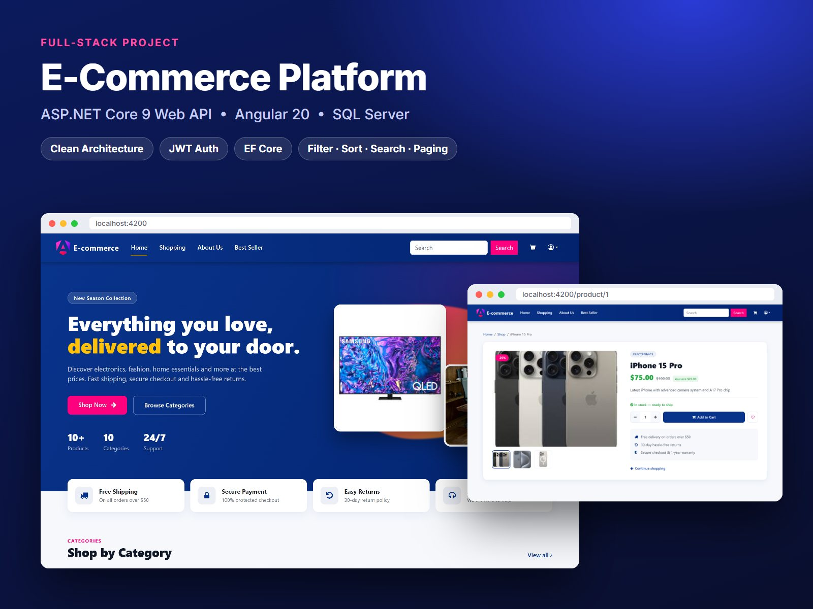
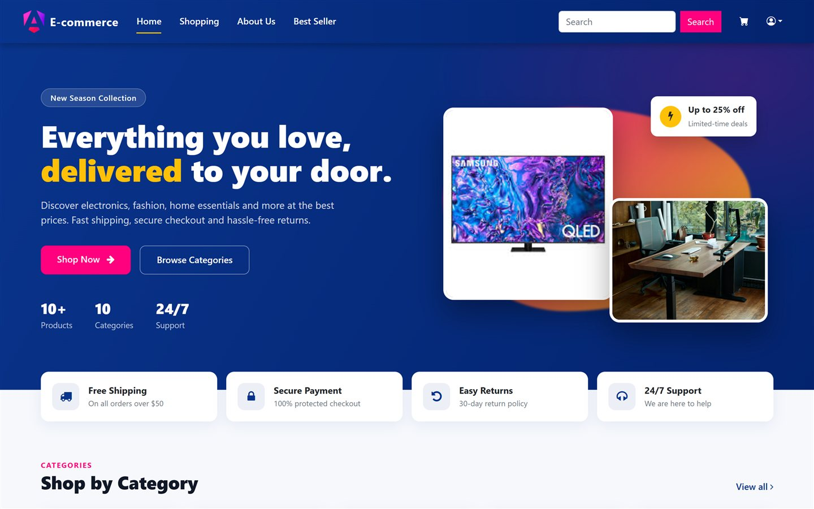
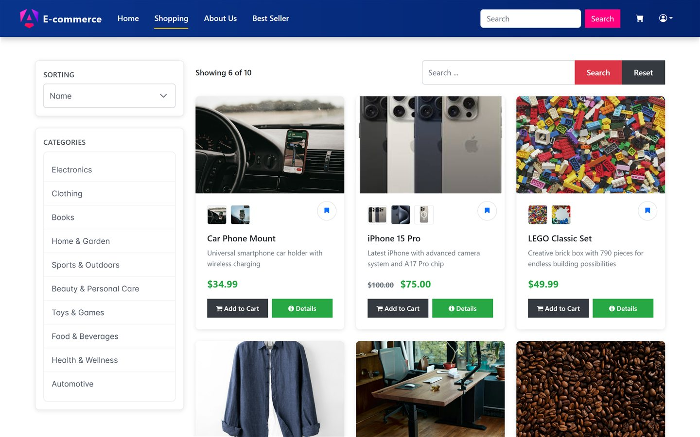
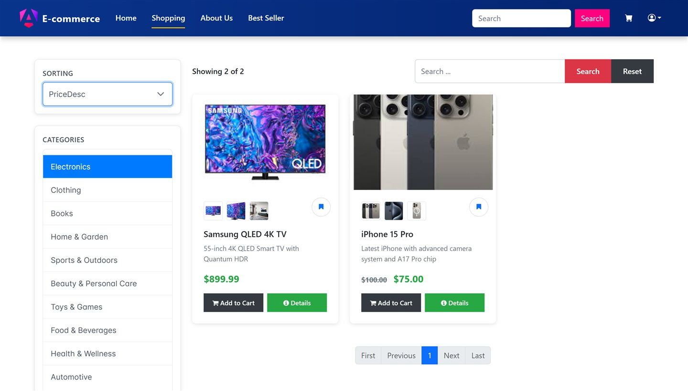
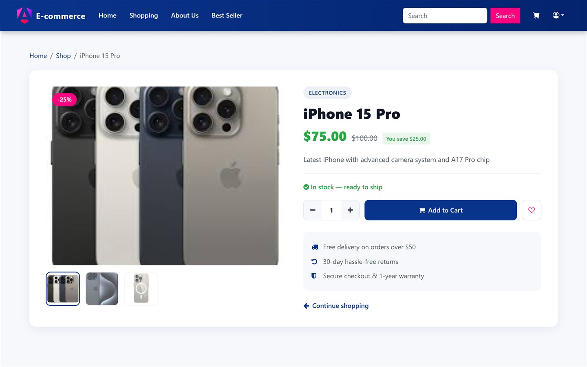

# E-Commerce Storefront — Angular 20

Responsive storefront for a full-stack e-commerce project, built with **Angular 20**, **Bootstrap 5** and **PrimeNG**, and backed by an ASP.NET Core 9 REST API.

**Backend (ASP.NET Core 9 API):** [HadyElMaageny/Ecom](https://github.com/HadyElMaageny/Ecom)



## Features

- **Home page:** hero section, category tiles that open the shop pre-filtered, featured products loaded from the API
- **Shop:** category filter, sorting (name / price ascending / price descending), live search and server-side pagination
- **Product details:** image gallery with thumbnails, old/new price with an automatic discount badge, quantity selector, and loading/not-found states
- **Deep links:** `/shop?categoryId=7` opens the shop filtered to a category
- **Responsive layout** built with Bootstrap's grid

## Screenshots

| Home | Shop |
|---|---|
|  |  |

| Filter & sort | Product details |
|---|---|
|  |  |

## Tech stack

Angular 20 · TypeScript · RxJS · Bootstrap 5 · PrimeNG · ngx-bootstrap · SCSS

## Project structure

```
src/app
├── core/       Navbar
├── home/       Landing page
├── shop/       Shop page, product card, product details, ShopService (API calls)
└── shared/     Models (IProduct, ICategory, ProductParams) and pagination component
```

## Getting started

**Prerequisites:** Node.js 20+ and the [backend API](https://github.com/HadyElMaageny/Ecom) running on `http://localhost:5000`.

```bash
git clone https://github.com/HadyElMaageny/Econ-client.git
cd Econ-client
npm install
npm start
```

Open **http://localhost:4200**. Use port 4200: the API's CORS policy only allows that origin.

## Roadmap

- Shopping cart and checkout
- Login / register pages on top of the existing API endpoints
